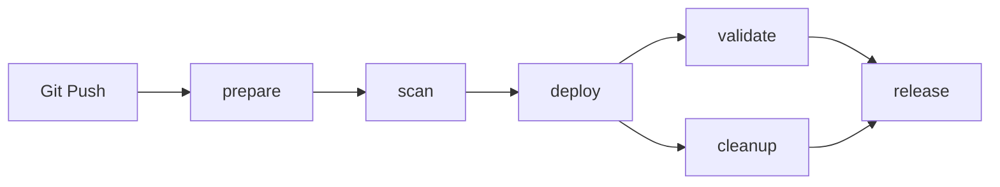
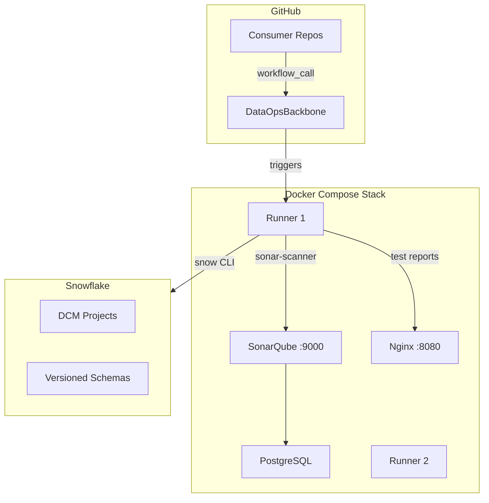
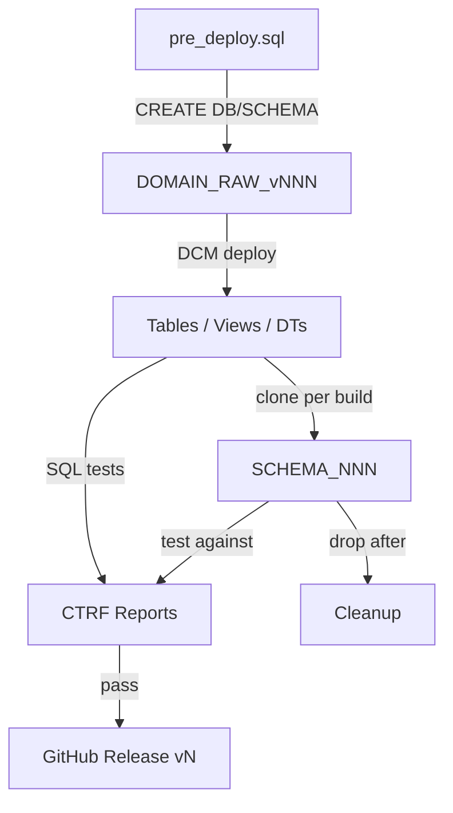
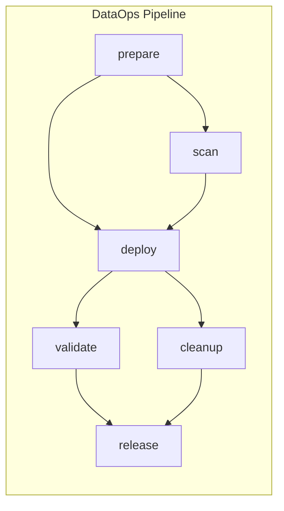

# **DataOps Unchained: Infrastructure that Scales**

[](https://github.com/zbrainiac-labs/DataOpsBackbone/actions/workflows/ci.yml)

> **A hands-on reference architecture for fully automated SQL code quality pipelines using SonarQube, GitHub Actions, and Snowflake.**

---

## Why / What / How

### Why?
#### In large, federated organizations, scaling analytics isn't (just) a tech challenge — it's an operational one.

From a technological and operational perspective, automation, governance and consistency are vital for scaling analytics in large, federated organisations. With agile methodology and modularisation, deployment volume can rise to hundreds or thousands per day, so manual QA simply cannot keep pace. For example, if 15 analytics teams were to deploy changes daily, the number of full-time reviewers required for manual reviews would be prohibitively high, resulting in bottlenecks, missed checks and an increased risk of inconsistent standards and data incidents.
DataOpsBackbone addresses these issues by automating every critical step:

**Quality Gates** leverage **SonarQube** code scans to enforce SQL and customisable coding rules based on regular expressions, which are applied automatically with every git push request. For example, forgetting to prefix a schema name or hardcoding a database name triggers an automated block and feedback, thereby enforcing standards before code can be shipped.
- Releases are versioned and deployed via DCM (Database Change Management) with plan/deploy semantics, then validated through SQL tests. This keeps production safe from changes that have not been properly tested.
- Governance is built in: rules such as 'no grants to PUBLIC' or 'only UTC TIMESTAMP allowed' are continuously enforced, and all compliance-relevant data (such as SQL code scans and test results) is logged for auditing purposes.
- Teams have full transparency and can be agile and reduce technical debt themselves. Automation enforces rules and monitors testing over time, so centralised approvals no longer become a bottleneck.

This setup offers repeatability, auditability and peace of mind, enabling new teams to get up and running quickly and allowing developers to focus on creating value rather than policing standards. The showcased projects are practical blueprints for achieving reliable, scalable analytics operations with Snowflake and GitHub Actions, not just demos.

---

### What?

A DataOps pipeline that automates:

- SQL linting & validation (SonarQube + regex rules + SQLFluff)
- Declarative schema deployment via Snowflake DCM (Database Change Management)
- SQL validation testing against deployed objects (CTRF JSON reports)
- Test trend reporting via UnitTestHistory v3.0
- Packaging deployable artifacts

#### Overview of the infrastructure:
#### CI/CD Pipeline Flow (6 composable jobs):



#### Runtime Component Topology:



#### Snowflake Object Lifecycle:




---

### How?

It combines:

- **GitHub Actions** — reusable workflow called by all consumer repos
- **Self-hosted runners** (2 org-level runners on `zbrainiac-labs`)
- **SonarQube** extended with SQL & Text plugins
- **Docker Compose** for local stack orchestration
- **Snowflake CLI** with DCM for declarative deployment (`DEFINE` syntax + Jinja templating)
- **SQL Validation** with CTRF JSON test reports
- **UnitTestHistory** for HTML trend dashboards

---

## Reusable Workflow Architecture

DataOpsBackbone provides a **single reusable GitHub Actions workflow** that all consumer repos call:

```yaml
# In each consumer repo (.github/workflows/pipeline.yml):
permissions:
  id-token: write
  contents: read

jobs:
  pipeline:
    uses: zbrainiac-labs/DataOpsBackbone/.github/workflows/dataops-pipeline.yml@main
    with:
      SOURCE_DATABASE: <DB_NAME>
      SOURCE_SCHEMA: <SCHEMA_NAME>
      DCM_PROJECT_IDENTIFIER: <DB.SCHEMA.PROJECT>
      DCM_TARGET: DEV
    secrets: inherit
```

### Pipeline Jobs (6 composable jobs):



| Job | Timeout | Purpose |
|-----|---------|---------|
| **prepare** | 10 min | Validate inputs, OIDC auth, pre-deploy SQL |
| **scan** | 30 min | Extract deps, SQLFluff, SonarQube, Quality Gate |
| **deploy** | 20 min | Clone (optional), DCM deploy, post-deploy, custom scripts |
| **validate** | 15 min | SQL validation tests, CTRF-to-SonarQube conversion |
| **cleanup** | 10 min | Drop clone schema (always runs if clone enabled) |
| **release** | 15 min | Deploy to original, zip, GitHub release, summary |

### Authentication

The pipeline uses **OIDC Workload Identity Federation** by default (secretless). GitHub issues a short-lived token per job that Snowflake validates directly. No PAT or stored secrets needed.

Fallback to `SNOW_CONFIG_B64` (PAT-based) is available via `USE_OIDC: false`.

> **Note:** `SNOWFLAKE_ACCOUNT` is required when using OIDC auth (`USE_OIDC: true`).
> When using PAT fallback (`USE_OIDC: false`), the account is taken from the Snowflake CLI's configured connection in `SNOW_CONFIG_B64`.

#### OIDC Setup (one-time, org-level)

**1. Configure GitHub org OIDC subject claim:**

Go to: https://github.com/organizations/YOUR_ORG/settings/actions/oidc-configuration

Set "Subject claim template" to: `repository_owner`

Then apply via API (requires `admin:org` scope):
```bash
gh auth refresh -h github.com -s admin:org
gh api -X PUT orgs/YOUR_ORG/actions/oidc/customization/sub \
  --input - <<< '{"include_claim_keys":["repository_owner"]}'
```

This makes all repos in the org emit the same OIDC subject: `repository_owner:YOUR_ORG`

**2. Configure Snowflake service user:**

```sql
USE ROLE ACCOUNTADMIN;
ALTER USER SVC_CICD SET
  WORKLOAD_IDENTITY = (
    TYPE = OIDC
    ISSUER = 'https://token.actions.githubusercontent.com'
    SUBJECT = 'repository_owner:YOUR_ORG'
  );
```

**3. Add `id-token: write` to consumer repo callers:**

```yaml
permissions:
  id-token: write
  contents: write
  actions: read
  checks: write
```

**4. No secrets needed** — remove `SNOW_CONFIG_B64` org secret after verification.

#### Local Development (PAT-based fallback)

For local development, the `SNOW_*` values in `.env` are used by `local-ci/run.sh` (act has no OIDC) and to create the `SNOW_CONFIG_B64` secret with `local-ci/snow-config.sh`. The runner containers get no Snowflake credentials; each job configures its own connection.

### Pipeline Hardening (built-in):
- **OIDC auth** — secretless, short-lived tokens per job (no stored PAT)
- **Multi-job architecture** — parallelization, resumability, clear failure boundaries
- **Environment protection** — `environment:` on deploy/release for approval gates
- **Concurrency control** — prevents parallel deploys to the same schema
- **Input validation** — regex-validated database/schema/project identifiers
- **Shell strict mode** — `set -Eeuo pipefail` catches silent failures
- **Retry logic** — 3 attempts with exponential backoff on Snowflake operations
- **Timeouts** — per-job timeouts prevent runaway execution
- **Pinned actions** — all GitHub Actions pinned to commit SHAs
- **Identifier quoting** — Snowflake `IDENTIFIER()` for defense-in-depth
- **DRY_RUN mode** — scan without deploying (for PR validation)

### Enabling Quality Gate Enforcement

To block deployments on SonarQube quality gate failure, set `QUALITY_GATE_ENFORCED: true` in your consumer repo's workflow caller:

```yaml
jobs:
  pipeline:
    uses: zbrainiac-labs/DataOpsBackbone/.github/workflows/dataops-pipeline.yml@main
    with:
      SOURCE_DATABASE: MY_DB
      SOURCE_SCHEMA: MY_SCHEMA
      DCM_PROJECT_IDENTIFIER: MY_DB.MY_SCHEMA.MY_PROJECT
      QUALITY_GATE_ENFORCED: true
    secrets: inherit
```

When disabled (default), quality gate failures are reported but do not block the pipeline.

### Using your own SonarQube analysis

If the consumer repo runs its own Sonar analysis (e.g. with tests and coverage), set `SONAR_SCAN: false`.
SonarQube Community Build has no branch analysis, so two analyses on the same project key (the repo name)
overwrite each other on every run. With `SONAR_SCAN: false` the scan job still runs SQLFluff
(report uploaded as the `sqlfluff-issues-<run number>` artifact) but skips the Sonar upload and quality gate.
`QUALITY_GATE_ENFORCED` then has no effect (the scan job logs a warning); enforce the gate in your own analysis.
Use the same SonarQube server so the custom SQL rules (`txt:`/`SQLCC:`) still apply to your project.
To keep the SQLFluff findings in your own project, pass the report to your scanner with
`-Dsonar.externalIssuesReportPaths=sqlfluff_issues.json` (generate it with `sqlfluff-to-sonar.sh` from the runner image).

### Consumer Repos:
| Repo | Database | DCM Schema | Data Schemas | Clone per Build |
|------|----------|------------|--------------|:---:|
| [mother-of-all-Projects](https://github.com/zbrainiac-labs/mother-of-all-Projects) | OPS_DEV | OPS_DCM | OPS_RAW_v001 | ✅ |
| [project-one](https://github.com/zbrainiac-labs/project-one) | ONE_DEV | ONE_DCM | ONE_RAW_v001 | ✅ |
| [MasterDataManagement](https://github.com/zbrainiac-labs/MasterDataManagement) | MDM_DEV | MDM_DCM | MDM_RAW_v001, MDM_AGG_v001, MDM_SRV_v001 | |
| [crm_dcm_project](https://github.com/zbrainiac-labs/crm_dcm_project) | CRM_DEV | CRM_DCM | CRM_RAW_v001, CRM_CUR_v001 | |
| [SyntheticRetailBank](https://github.com/zbrainiac-labs/SyntheticRetailBank) | AAA_DEV_SYNTHETIC_BANK | AAA_DCM | CRM_RAW_v001, PAY_RAW_v001, ... | ✅ |
| [sharing_any_objects](https://github.com/zbrainiac-labs/sharing_any_objects) | ECO_DEV | ECO_DCM | ECO_RAW_v001 | ✅ |
| [crew-asset-management](https://github.com/zbrainiac-labs/crew-asset-management) | SAM_DEMO | SAM_DCM | SAM_RAW_v001 | |
| [hadoop-to-snowflake](https://github.com/zbrainiac-labs/hadoop-to-snowflake) | HAM_DEV | HAM_DCM | HAM_RAW_v001 | |

---

## Project Structure

```
DataOpsBackbone/
├── .github/workflows/
│   ├── dataops-pipeline.yml    # Reusable pipeline (6 jobs + finish/trace), every step traced
│   └── ci.yml                  # Lint/tests, Trivy, SonarQube gate; publishes images from main/tags
├── github-runner/
│   ├── Dockerfile              # Runner image (Ubuntu 26.04, SQLFluff, yq, act, docker CLI, otel-cli)
│   ├── entrypoint.sh           # Ephemeral runner registration (one job per registration)
│   ├── lib.sh                  # Step helpers: retry, otel_step, otel_span (loaded via BASH_ENV)
│   ├── snowflake-config-setup.sh       # Decode SNOW_CONFIG_B64 (PAT fallback)
│   ├── sonar-rules-setup.sh    # Create SonarQube quality profile + custom rules (sonar-init)
│   ├── sonar-token-init.sh     # Create shared SONAR_TOKEN, revoke old runner-* tokens (sonar-init)
│   ├── sonar-scan.sh           # Run sonar-scanner + import SQLFluff + test results
│   ├── sonar-quality-gate.sh   # Wait for analysis + check Quality Gate (token never in job env)
│   ├── sqlfluff-to-sonar.sh    # Run SQLFluff → SonarQube Generic Issue format (+ fail threshold)
│   ├── sqlfluff_to_sonar.py    # JSON converter (SQLFluff → SonarQube)
│   ├── ctrf_to_sonar_converter.py  # CTRF JSON → SonarQube Test Execution XML
│   ├── sqlfluff_sonar.cfg      # SQLFluff config (non-overlapping rules only)
│   ├── ddl_uppercase_keywords.py # Normalize GET_DDL() output
│   ├── sql-validate.sh         # SQL tests → CTRF JSON
│   ├── snowflake-clone-schema.sh       # Per-build schema + DCM project + manifest rewrite
│   ├── snowflake-drop-clone-schema.sh
│   ├── snowflake-deploy-dcm.sh
│   ├── snowflake-extract-dependencies.sh
│   ├── render-sql.sh           # Jinja-style template rendering
│   ├── unitth.jar              # UnitTestHistory v3.0
│   └── tests.sqltest           # Sample test file
├── local-ci/
│   ├── run.sh                  # Run a consumer's pipeline locally with act (no commit/push)
│   ├── snow-config.sh          # Build SNOW_CONFIG_B64 from .env (local-ci + GitHub secret)
│   ├── observability-smoke.sh  # Observability parity/health check (--quick used by start.sh)
│   └── sonar-self-scan.sh      # Scan this repo with local SonarQube, fail on BLOCKER/CRITICAL
├── sqlfluff/                   # Standalone SQLFluff linter (alternative to SonarQube)
│   ├── .sqlfluff               # SQLFluff config (all rules)
│   ├── lint.py                 # Combined runner: SQLFluff + custom regex rules
│   ├── plugins/dataops_rules/  # 28 custom regex rules (DO01–DO28)
│   └── test_sql/               # Good/bad SQL examples for testing
├── docs/
│   ├── QUICKSTART.md           # 15-minute first pipeline guide
│   ├── TROUBLESHOOTING.md      # Per-job failure/recovery guide + local simulation
│   ├── PROMOTION.md            # Promotion flow dev -> prod
│   ├── SQL-RULES.md            # Rule regex patterns, scanner config, rule ownership
│   └── OBSERVABILITY.md        # Pipeline tracing + reports (OpenTelemetry, VictoriaTraces/-Metrics, Grafana)
├── observability/
│   ├── otel-collector.yaml     # OTLP in, spans -> VictoriaTraces, spanmetrics -> VictoriaMetrics
│   └── grafana/                # Provisioned data sources + 3 read-only dashboards (folder DataOps)
├── sonarqube/
│   ├── Dockerfile              # Custom SonarQube image
│   ├── quality-profiles/       # Exported custom quality profiles
│   └── db-init/                # Optional DB dump, loaded on fresh volume (gitignored)
├── nginx/default.conf          # Nginx for test report serving
├── images/                     # Documentation images
├── sonar-project.properties    # Self-scan config for this repo
├── docker-compose.yml          # SonarQube, sonar-init, 2 ephemeral runners, observability (4), nginx; profile: local-ci
└── start.sh                    # One-command startup (detached, observability included); --no-observability skips it
```

---
## Architecture Overview - Data objects

The showcase is built around two distinct data domains, each represented as an individual database within the same Snowflake account. This approach allows for logical isolation and independent management of domain-specific data assets.

Within each domain (database), schemas are strategically utilized to achieve two key objectives:
* **Maturity Levels:** Schemas separate data objects based on their maturity level (e.g., raw, curated, conformed). This provides a clear path for data as it progresses through various transformation stages.
* **Versioning:** Schemas also incorporate versioning for underlying database objects like tables, views, stages and procedures. This ensures traceability, facilitates rollbacks, and supports agile development by allowing iterative changes without disrupting existing consumers.

### Why This Approach?
1. **Improved Organization:** Data assets are logically grouped by business domain, making them easier to discover and manage.
2. **Enhanced Data Governance:** Clear maturity levels and versioning promote better control over data quality and evolution.
3. **Scalability & Maintainability:** The modular design reduces interdependencies, simplifying development, testing, and maintenance.
4. **Demonstrates Best Practices:** Provides a practical example of implementing a domain-driven data architecture in Snowflake.


### Drive modularization for better Resilience

We not only use static source code analysis to review new code coming into the environment, but also check the existing setup and enforce isolation more effectively.
By isolating domains and versions, the impact of changes or failures in one area on others is minimised, thereby enhancing overall system stability and aiding regression testing.


---

## Naming Convention

All Snowflake object names use **UPPERCASE** with underscore separators.

### Database: `{DOMAIN}_{ENV}`

| Position | Field | Values |
|----------|-------|--------|
| 1-3 | Domain | 3-char business domain (`IOT`, `CLR`, `PAY`, `CRM`, `REF`) |
| 4-7 | Environment | `_DEV`, `_TE1`, `_PER`, `_PRD` |

Examples: `CLR_DEV`, `PAY_PRD`, `IOT_TE1`

### Schema: `{DOMAIN}_{MATURITY}_v{NNN}` or `{DOMAIN}_DCM`

| Position | Field | Values |
|----------|-------|--------|
| 1-3 | Domain | Same 3-char domain code |
| 4-8 | Maturity | `_RAW_`, `_CUR_`, `_AGG_`, `_GOL_` |
| 9-12 | Version | `v001` -- `v999` |

DCM schemas use `{DOMAIN}_DCM` (unversioned) — one per database, holds the DCM project definition.

Examples: `CRM_RAW_v001`, `IOT_AGG_v012`, `REF_CUR_v003`, `OPS_DCM`, `CRM_DCM`

### Database Objects (tables, views, stages, tasks, etc.): `{DOMAIN}{COMP}_{MATURITY}_{TYPE}_{TEXT}`

| Position | Field | Description | Values |
|----------|-------|-------------|--------|
| 1-3 | Domain | 3-char business domain | `IOT`, `CLR`, `PAY`, `CRM`, `REF` |
| 4 | Component | Sub-component (GitHub repo) | Single char: `I`, `A`, `T`, `P`, etc. |
| 5-8 | Maturity | Data maturity level | `_RAW`, `_CUR`, `_AGG`, `_GOL` |
| 9-12 | Object type | Snowflake object type | `_TB_`, `_VW_`, `_DT_`, `_ST_`, `_FF_`, `_SP_`, `_TK_` |
| 13+ | Free text | Business-meaningful name | Uppercase, underscores allowed |

Examples:
- `ICGI_RAW_TB_SWIFT_MESSAGES` -- ICG domain, Ingestion repo, raw table
- `ICGA_AGG_DT_SWIFT_PACS008` -- ICG domain, Aggregation repo, aggregated dynamic table
- `IOTI_RAW_VW_SENSOR_GEOLOC` -- IOT domain, Ingestion repo, raw view
- `ICGI_RAW_ST_SWIFT_INBOUND` -- ICG domain, Ingestion repo, raw stage
- `ICGI_RAW_FF_XML` -- ICG domain, Ingestion repo, raw file format

---
## SQL Linting Rules

82 rules across SonarQube (regex + AST) and SQLFluff, with no overlap. Summary in [RULES.md](RULES.md); regex patterns and examples in [docs/SQL-RULES.md](docs/SQL-RULES.md).

## Monitoring
### Issue overview


### Issue within code


### Technical debt


### Monitor the history of test case execution


The history lives in UnitTH run stores, one JSON file per project in `./unitth-store/` (mounted at `/home/docker/unitth-store` in both runners):

- `sql-validate.sh` ingests each new CTRF run into `unitth-store/<owner>_<repo>.json` and rebuilds the report on http://localhost:8080 from all stores (`--store-dir`). Each store keeps the newest 100 runs.
- The run folder in `./sql-unit-reports/` is deleted only after UnitTH reports `ingest=ok` for that run. A copy of the CTRF file stays in the job workspace for the SonarQube conversion step.
- Concurrent runs of the same project are serialised by a lock on `<store>.lock`. After 60 s the ingest is skipped with a warning and the run folder is kept.
- Old run folders are moved into the stores once with `UnitTH/e2e/migrate-ctrf-history.sh` (dry-run by default, `--apply` to delete). Back up `./sql-unit-reports/` into `./archive/` first.

### Pipeline tracing (OpenTelemetry)

Pipeline traces and reports start with the stack: Grafana on http://localhost:3000 (folder "DataOps": Pipeline overview, Jobs and steps, Traces; one trace service per project). `./start.sh --no-observability` turns it off. Architecture, reports and the Jaeger mapping: [docs/OBSERVABILITY.md](docs/OBSERVABILITY.md).

## SonarQube + SQLFluff — Integrated Scanning

SQLFluff issues are imported into SonarQube as external issues, so there is one dashboard. Scanner config, rule ownership and DDL post-processing: [docs/SQL-RULES.md](docs/SQL-RULES.md).

## Quick Setup Guide


### Step 1: Create CICD role and service user

Each consumer repo has its own `pre_deploy.sql` that creates the database, schema, and DCM project. The CICD role and service user must be created once manually:

```SQL
USE ROLE ACCOUNTADMIN;
CREATE ROLE IF NOT EXISTS CICD;
GRANT CREATE DATABASE ON ACCOUNT TO ROLE CICD;
GRANT CREATE ROLE ON ACCOUNT TO ROLE CICD;
GRANT CREATE WAREHOUSE ON ACCOUNT TO ROLE CICD;
GRANT MANAGE WAREHOUSES ON ACCOUNT TO ROLE CICD;
GRANT EXECUTE TASK ON ACCOUNT TO ROLE CICD;
GRANT EXECUTE MANAGED TASK ON ACCOUNT TO ROLE CICD;
GRANT IMPORTED PRIVILEGES ON DATABASE SNOWFLAKE TO ROLE CICD;
GRANT ROLE CICD TO USER SVC_CICD;
```


### Step 2: Generate a PAT for the service user

```SQL
ALTER USER IF EXISTS SVC_CICD ADD PROGRAMMATIC ACCESS TOKEN CICD_PAT
  ROLE_RESTRICTION = CICD
  DAYS_TO_EXPIRY = 365
  COMMENT = 'CI/CD pipeline PAT';
-- copy <your token>
```

### Step 3: Configure `.env` (single source of truth)

All configuration lives in one file. The runner auto-generates `SONAR_TOKEN` at startup; `local-ci/snow-config.sh` builds `SNOW_CONFIG_B64` from the `SNOW_*` values when you need it.

```dotenv
# GitHub
GH_RUNNER_TOKEN=<...>
GITHUB_OWNER=<your GitHub org/user>
GITHUB_ORG=<your GitHub org for org-level runners>
GH_ORG_TOKEN=<classic PAT with admin:org scope>

# SonarQube (SONAR_TOKEN is auto-generated at runner startup)
POSTGRES_USER=sonar
POSTGRES_PASSWORD=sonar
POSTGRES_DB=sonarqube
SONAR_JDBC_USERNAME=sonar
SONAR_JDBC_PASSWORD=sonar
SONAR_ADMIN_PASS=<CHANGE_ME_STRONG_PASSWORD>

# Snowflake (PAT fallback + local-ci; build SNOW_CONFIG_B64 with local-ci/snow-config.sh)
CONNECTION_NAME=<your-connection-name>
SNOW_ACCOUNT=<your-account>
SNOW_USER=SVC_CICD
SNOW_ROLE=CICD
SNOW_DATABASE=DATAOPS
SNOW_SCHEMA=IOT_RAW_V001
SNOW_WAREHOUSE=MD_TEST_WH
SNOW_PAT=<your PAT from Step 2>

# Observability (see docs/OBSERVABILITY.md); not needed with --no-observability
GRAFANA_ADMIN_PASSWORD=<CHANGE_ME_STRONG_PASSWORD>   # required, must not be "admin"
OBSERVABILITY_RETENTION=365d
OBSERVABILITY_MAX_DISK=20GiB
```

---
### Step 4: Configure Authentication

**Option A: OIDC (recommended, secretless)** — see "OIDC Setup" section above. No GitHub secrets needed.

**Option B: PAT fallback** — set `USE_OIDC: false` in consumer repos and upload the secret:

```bash
bash local-ci/snow-config.sh | gh secret set SNOW_CONFIG_B64 --org zbrainiac-labs --visibility all
```

`SONAR_TOKEN` and `SNOW_CONNECTION_NAME` secrets are **no longer needed** -- they are auto-generated at runtime.

---

### Step 5: Run It

1. Start your local stack via `./start.sh`
2. Access SonarQube at: [http://localhost:9000](http://localhost:9000)  
  **Login**: `admin` / `<your SONAR_ADMIN_PASS from .env>`

  > **Warning**: Never use example passwords in production. Set unique, strong values in your `.env` file.
3. Push to any consumer repo — the reusable workflow triggers automatically
4. Check results in SonarQube
5. Monitor SQL test results (incl. history) at: [http://localhost:8080](http://localhost:8080)
6. Pipeline reports and traces in Grafana: [http://localhost:3000](http://localhost:3000) (read-only without login; admin: `GRAFANA_ADMIN_PASSWORD`)

---

## Docker Compose Services

| Service | Purpose | Port |
|---------|---------|------|
| `sonarqube` | Code quality + custom SQL rules | 9000 |
| `db` | PostgreSQL backend for SonarQube (optional dump in `sonarqube/db-init/`) | - |
| `sonar-init` | One-shot: shared Sonar token + custom rules, then exits | - |
| `runner` (x2) | Ephemeral org-level self-hosted GitHub runners | - |
| `nginx-server` | Serves UnitTestHistory HTML reports | 8080 |
| `otel-collector` | Receives pipeline spans (OTLP), derives spanmetrics | 127.0.0.1:4317/4318 |
| `victoriatraces` | Trace storage, Jaeger Query API | 127.0.0.1:10428 |
| `victoriametrics` | Spanmetrics storage, Prometheus API | 127.0.0.1:8428 |
| `grafana` | Pipeline reports + trace search (folder DataOps) | 127.0.0.1:3000 |
| `local-ci` | Local workflow simulation with act, profile `local-ci` | - |

---

## Compatibility Matrix

| Component | Minimum | Tested | Notes |
|-----------|---------|--------|-------|
| Snowflake CLI | 3.16.0 | 3.32.1 | OIDC requires >= 3.11 |
| SonarQube | 10.0+ | 26.11 (Community Build) | Scanner 8.x requires 10+ |
| Sonar Scanner CLI | 8.0.0 | 8.3.1.16491 | Use 5.x for SonarQube 9.x |
| SQLFluff | 3.0+ | 4.5 | Snowflake dialect |
| GitHub Actions Runner | 2.327+ | 2.338.2 | Self-hosted, Linux x64/arm64; Node 24 actions |
| Docker Compose | v2+ | v2.x | No `version:` key needed |
| PostgreSQL | 15+ | 17.11 | SonarQube backend |
| Python | 3.10+ | 3.14 | Runner image (Ubuntu 26.04, venv in /opt/venv) |
| yq | 4.x | 4.54.1 | Built from source in the image |
| Java | 21 | eclipse-temurin:21.0.13_9-jre-resolute | Scanner + UnitTestHistory |
| OpenTelemetry Collector | contrib | 0.164.0 | OTLP in, span_metrics connector |
| VictoriaTraces | 0.12 | v0.12.1 | Pre-1.0: smoke-test every bump |
| VictoriaMetrics | 1.x | v1.155.0 | `-opentelemetry.usePrometheusNaming` |
| Grafana | 13.x | 13.3.0 | Majors upgraded manually |

---

## Final Thoughts

This is not just a demo. It's a **reusable framework** to scale DataOps -- combining validation, governance, and automation into one consistent, testable workflow.
