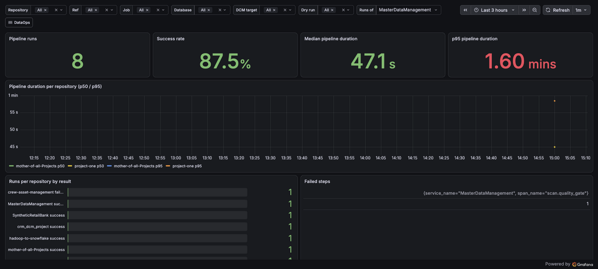

# Observability

## Pipeline tracing (OpenTelemetry)

Every `run:` step in `dataops-pipeline.yml` is wrapped in `otel_step` (`github-runner/lib.sh`): it logs a begin/end line with exit code and duration, and exports one span per step. All jobs of one run share a trace (trace id derived from `run_id` + attempt):

```
pipeline <repo>          overall result (finish job)
├── job <name>           full job duration incl. checkout/connect, result, runner name
│   ├── queue <name>     time waiting for a runner (GitHub API; not in local-ci)
│   └── <step>           e.g. scan.sonar, deploy.dcm — exit code + duration
```

The service name is the consumer repo (e.g. `project-one`).

## Architecture

```
runners (otel-cli in lib.sh) ──OTLP gRPC otel-collector:4317──┐
local-ci act jobs ─────────────host.docker.internal:4317──────┤
                                                              ▼
                                                       otel-collector
                                          all spans │              │ spanmetrics
                                                    ▼              ▼
                                            VictoriaTraces   VictoriaMetrics
                                             (Jaeger API)    (Prometheus API)
                                                    └──────┬───────┘
                                                           ▼
                                               Grafana http://localhost:3000
```

| Service | Image | Port (127.0.0.1 only) | Config |
|---|---|---|---|
| `otel-collector` | `otel/opentelemetry-collector-contrib` | 4317 (gRPC), 4318 (HTTP), 13133 (health) | `observability/otel-collector.yaml` |
| `victoriatraces` | `victoriametrics/victoria-traces` | 10428 | compose flags |
| `victoriametrics` | `victoriametrics/victoria-metrics` | 8428 | compose flags |
| `grafana` | `grafana/grafana` | 3000 | `observability/grafana/` |

All four run on the `otelnet` network; SonarQube and Postgres are not reachable from it. Every port is bound to `127.0.0.1`, so Grafana allows anonymous read-only viewing; log in as `admin` with `GRAFANA_ADMIN_PASSWORD` for anything else.

```bash
./start.sh                           # observability starts by default; quick health check at the end
./start.sh --no-observability        # the four services are not started; runners get no OTLP endpoint
bash local-ci/observability-smoke.sh # full parity check (writes one trace with service "smoke-test")
```

`.env` keys:

| Key | Default | Meaning |
|---|---|---|
| `GRAFANA_ADMIN_PASSWORD` | none (required) | Grafana admin password; `./start.sh` stops if missing or `admin` |
| `OBSERVABILITY_RETENTION` | `365d` | Retention for traces and metrics |
| `OBSERVABILITY_MAX_DISK` | `20GiB` | Disk cap for VictoriaTraces; oldest data is dropped first |

## From Jaeger to Grafana

| Jaeger UI | Grafana |
|---|---|
| Search: service, operation, tags, min/max duration, limit | **Traces** report (DataOps folder), or Explore with the `VictoriaTraces` data source |
| Trace waterfall | Click a trace ID in the **Traces** report or in **Pipeline overview → Latest runs** |
| Exact span durations (any length) | Unchanged; traces keep every attribute |
| *(none)* | Trends, percentiles and failure rates from spanmetrics |

## Reports (folder "DataOps")

Variables on every report: `repo`, `ref`, `job`, `database`, `target`, `dry_run`.



1. **Pipeline overview** (home dashboard): runs, success rate and median duration; p50/p95 per repo over time; runs per repo by result; latest runs with a link to the waterfall.
2. **Jobs and steps**: p95 per job; the 10 slowest steps; failure rate per step; queue time per job (GitHub runs only); step duration per database/target.
3. **Traces**: the Jaeger search fields plus the waterfall.

Dashboards are code and read-only in the UI (`allowUiUpdates: false`). To change one, edit it in Grafana, export the JSON into `observability/grafana/dashboards/` and open a PR (see CONTRIBUTING.md).

## Metrics

The collector's `span_metrics` connector writes, per span name and status:

- `traces_span_metrics_calls_total`
- `traces_span_metrics_duration_seconds_{bucket,sum,count}`, buckets `1s` to `2h`

Labels (dots become underscores): `service_name`, `span_name`, `status_code`, `vcs_repository`, `vcs_ref`, `cicd_job`, `cicd_pipeline_name`, `cicd_pipeline_result`, `cicd_job_result`, `cicd_dry_run`, `sf_database`, `sf_schema`, `dcm_target`, `exit_code`.

Per-run values (`cicd.pipeline.run.id`, `cicd.worker.name`, `cicd.job.queue_seconds`) are on the traces only, to keep the series count low (a few thousand).

## Retention, disk and reset

- Traces live in the `vtdata` volume, metrics in `vmdata`, Grafana state in `grafanadata`. Check sizes with `docker system df -v`.
- VictoriaTraces is capped by `OBSERVABILITY_MAX_DISK`. VictoriaMetrics stops accepting writes when less than 1 GiB disk is free; spanmetrics are small compared to the traces.
- Start fresh: `docker compose rm -sf otel-collector victoriatraces victoriametrics grafana && docker volume rm dataopsbackbone_vtdata dataopsbackbone_vmdata dataopsbackbone_grafanadata`, then `./start.sh`.
- Moving from the old Jaeger setup: `docker compose rm -sf jaeger && docker volume rm dataopsbackbone_jaeger_v2_data`. Old Jaeger traces are not migrated.

## Behaviour and versions

- Fail-open: a stopped collector or backend never fails a step. `./start.sh` only warns when a health check fails.
- Disable per consumer with the workflow input `OTEL_ENABLED: false`.
- `local-ci/run.sh` sends traces automatically when `otel-collector` is running.
- VictoriaTraces is pre-1.0: the image is pinned, and every bump (Dependabot) must pass `local-ci/observability-smoke.sh`. Grafana majors are upgraded manually. The collector stays in front so the trace backend can be swapped without touching the runners.
